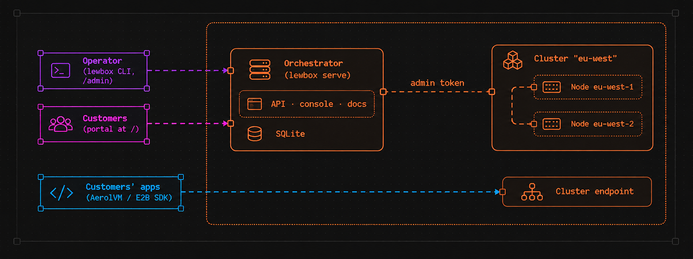

<h1 align="center">Lewbox</h1>

<p align="center">Run your own sandbox cloud on AerolVM: a self-hosted E2B.</p>

<p align="center">
  
</p>

---

### What it is

Lewbox is one Go binary, `lewbox`. It is both the server and the CLI.

- **The orchestrator**, `lewbox serve`, runs the HTTP API under `/v0`, the customer portal at `/`, the operator console at `/admin` and the documentation. It keeps everything in one SQLite file.
- **The CLI** installs [AerolVM](https://github.com/aerol-ai/microvm) on Linux machines, joins them into clusters (one per region), and registers them with the orchestrator, which keeps checking them.
- **Customers** get workspaces. Each workspace is one AerolVM team in one region, on a plan you set. The plan is pushed to the cluster as that team's quota, and Lewbox records usage.
- **Sandbox traffic skips Lewbox.** Customers' apps talk to the cluster directly with a sandbox API key and the AerolVM or E2B SDK.

### Quick start

You need a Linux machine with systemd and a normal user that can run `sudo`. Lewbox refuses to run as root. Get the binary from the [latest release](https://github.com/harlew-dev/lewbox/releases/latest) as shown in [Install the CLI](docs/platform/setup/install-the-cli.md), or build it with `make` (Go 1.27+ and Node 24+).

```bash
lewbox serve                                     # the orchestrator, on :8080
lewbox install --public-host 10.0.0.5            # on each machine, with its own IP
lewbox node add node-1 --new-cluster eu-west     # the first machine starts the cluster
lewbox node add node-2 --cluster eu-west         # every machine after it joins
lewbox cluster check eu-west
```

To sign in to `/admin`, set `LEWBOX_BOOTSTRAP_ADMIN_EMAIL` and `LEWBOX_BOOTSTRAP_ADMIN_PASSWORD` the first time you run `lewbox serve`.

The [Quickstart](docs/platform/getting-started/quickstart.md) does all of this on one machine in about five minutes. To get a multi-node cluster without spare servers, [try it with Docker](docs/platform/getting-started/try-with-docker.md).

### Documentation

- **[Platform documentation](docs/platform/README.md)** is for operators: setup, clusters, accounts and plans, operations, and the [CLI](docs/platform/reference/cli.md) and [HTTP API](docs/platform/reference/http-api.md) reference.
- **[Customer documentation](docs/consumer/README.md)** is for workspace members: sandbox API keys, the AerolVM and E2B SDKs, usage and limits, and the management API.

Both books are built into the binary. The console serves them at `/platform` and `/docs`.

### Contributing

Read [AGENTS.md](AGENTS.md) first. It covers the code layout and the project's rules. The web console has its own guide in [web/README.md](web/README.md).

```bash
make           # build the web console, then bin/lewbox
make run       # build, then serve on :8080
make test      # static checks, Go tests with the race detector, and web tests
```

Changes that touch a machine also need the end-to-end test against real AerolVM in Docker: [deploy/dev-cluster](deploy/dev-cluster/README.md).

### License

[MIT](LICENSE)
