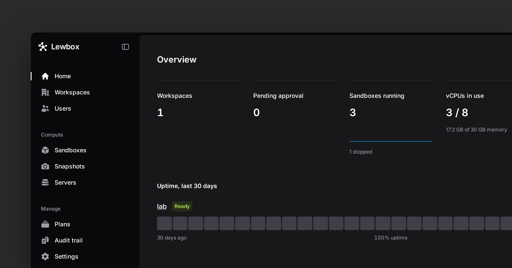

<h1>Lewbox</h1>

<p>Run your own sandbox cloud on AerolVM: a self-hosted E2B.</p>

<p align="center">
  
</p>

### Installation

Linux `amd64` or `arm64`, as a normal user with `sudo`:

```bash
curl -fsSL https://raw.githubusercontent.com/harlew-dev/lewbox/main/install.sh | sh
```

See [Install the CLI](docs/platform/setup/install-the-cli.md) for a pinned release, a custom install folder, installing with Go, or building from source.

### Documentation

Visit [lewbox.com](https://lewbox.com) for the hosted version, or read the books below.

- **[Platform documentation](docs/platform/README.md)** is for operators: setup, clusters, accounts and plans, operations, and the [CLI](docs/platform/reference/cli.md) and [HTTP API](docs/platform/reference/http-api.md) reference.
- **[Customer documentation](docs/consumer/README.md)** is for workspace members: sandbox API keys, the AerolVM and E2B SDKs, usage and limits, and the management API.

Both books are built into the binary. The console serves them at `/platform` and `/docs`.

### Contributing

Read the [contributing guide](CONTRIBUTING.md).

### License

[MIT](LICENSE)
